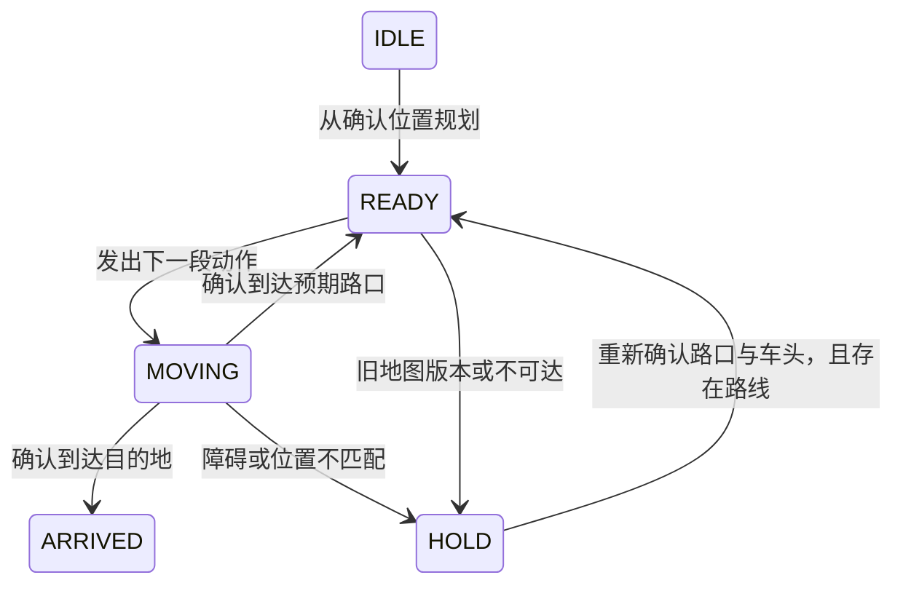

# 执行与重规划

规划器输出道路序列和 STRAIGHT/LEFT/RIGHT/UTURN 动作。实际电机动作由下层控制完成，当前仓库没有完整的循迹 PID 或车轮动力学。

## Python 事件模型

`mission-events.json` 是对这个事件模型实际调用产生的记录，属于仿真事件，不是实车传感器日志。

### 路口遇阻

位置仍被确认时，更新双向道路状态和地图版本，再从当前路口与实际车头重新搜索。

### 路段中遇阻

停止后当前位置不再被当作上一确认路口。系统保持 HOLD，记录 `NEEDS_LOCALIZATION`，需要传感器或人工在实验中重新确认位置后才能规划。当前没有实现自动倒车到路口或连续空间避障。

## 识别门槛

`LabelGate` 接收外部识别器的 top-1 类别、分数与第二名分数。默认连续 3 帧一致、置信度至少 0.8、分数间隔至少 0.15 才确认；低分、冲突或歧义清空累计。阈值未通过真实图像数据校准。

这只是识别结果确认模块。仓库没有相机驱动、数字 OCR 网络、误识别率评测或实际数字字模训练。

## C 停车锁定

`jp_motion_allowed` 检查计划版本、障碍、识别状态、位置状态和丢线计数。任何关键条件失败都锁定 HOLD。之后即使一帧传感器恢复正常，也不会自行恢复运动。

上层获得新计划、确认位置并重新检查传感器后调用 `jp_guard_arm`。若传入的新计划版本与实际地图版本仍不同，下一次动作许可检查仍返回 HOLD。控制层收到 HOLD 后必须实际将两侧 PWM 置零；本函数不会替调用方设置寄存器。

## 浏览器仿真

地图、策略、转弯成本和道路状态变化会重新规划。车位于已确认路口时可继续；在示意执行动画中点击阻塞道路或改变关键参数，会停止动画并要求位置确认。用户选择路口确认只代表仿真实验的重新定位输入，不能证明真实定位已经完成。

起始车头控件明确改变实验初始条件并重置到起点。返航使用当前路口和实际执行后保留的车头，未实现药品装卸、灯光提示或双车通信。
